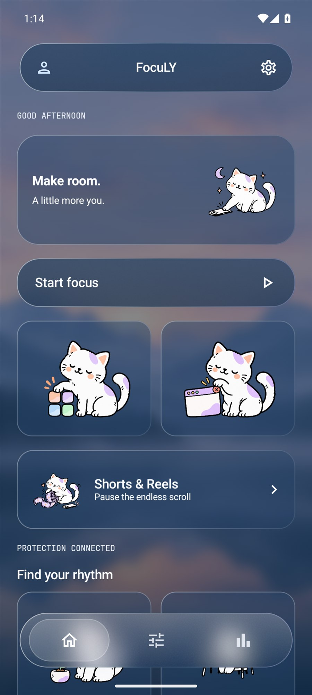
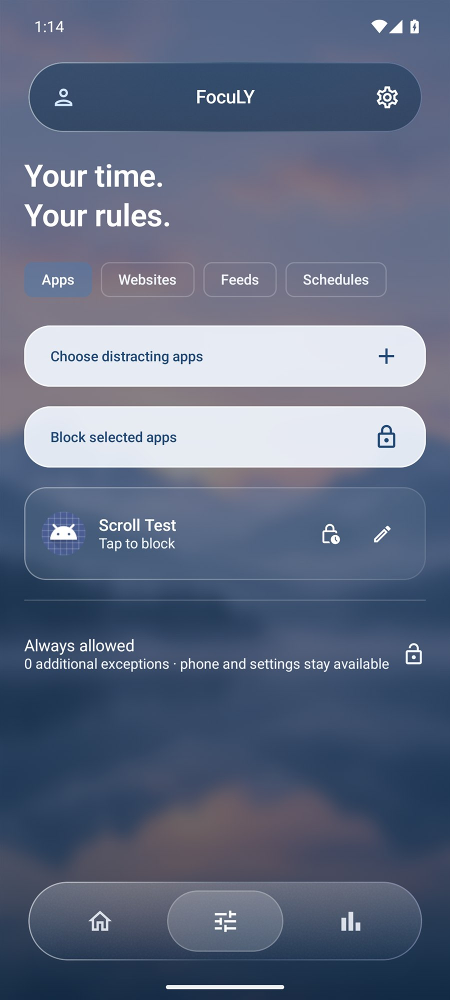
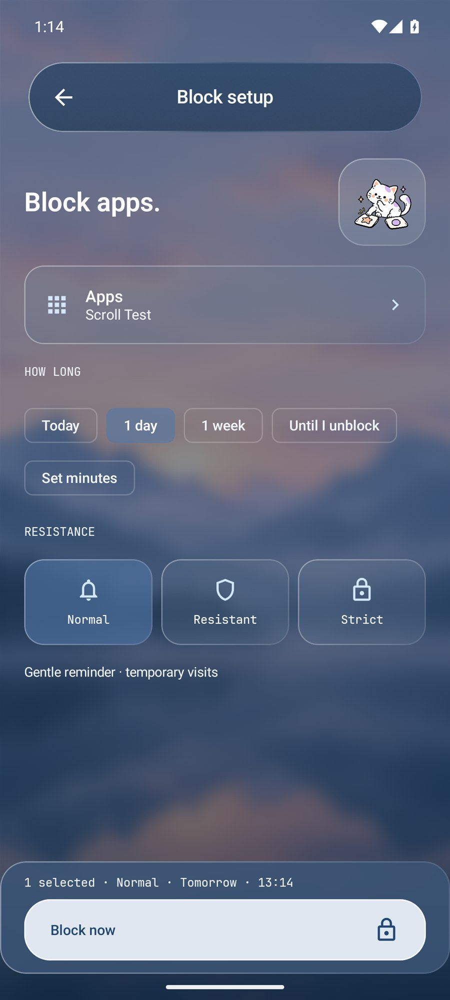

# FocuLY

### A little less scroll. A little more you.

An Android app for focus sessions, everyday boundaries, and intentional screen time.

**[Download v1.0.1](https://github.com/YumiNoona/Focus/releases/tag/v1.0.1)** · **[What's new](docs/CHANGELOG.md)** · **[Protection setup](docs/TROUBLESHOOTING.md)**

## Make room for what matters

- Block apps, websites, or feeds for today, a day, a week, custom minutes, or until you unblock them.
- Choose **Normal**, **Resistant**, or **Strict** interruptions. Strict requires an automatic ending and has no in-app temporary visits or early stop.
- Start a focus session, reuse a profile, or schedule weekday, weekend, and overnight routines.
- Set daily app budgets, per-visit limits, essential-app exceptions, and gradual reduction goals.
- Keep saved bans and original deadlines when a target app is uninstalled and reinstalled.
- Personalize blocking screens with cat doodles, your own image/sticker, messages, and emoji.
- Get optional illustrated break reminders for heavily used apps, including apps without a saved rule.
- View locally measured usage and session history, with widgets, a Quick Settings tile, and permission health.

A misty lake backdrop frames frosted top/bottom bars and floating focus actions. Exactly **three icons — Home, Rules, Insights** — sit at the bottom; Profile stays top left and Settings top right. Settings groups permissions in one dropdown, and the four rhythm cards feature larger cat illustrations. The sun/moon switch blends light/dark appearance smoothly; Reduce motion makes transitions instant.

## Screenshots

<table>
  <tr><th>Home</th><th>Rules</th><th>Block setup</th></tr>
  <tr>
    <td></td>
    <td></td>
    <td></td>
  </tr>
</table>

## Documentation

| Guide | Contents |
| --- | --- |
| [Features](docs/FEATURES.md) | Coverage, permissions, rule precedence, and measurements |
| [Blocking](docs/BLOCKS.md) | Durations, modes, unblocking, and overlapping rules |
| [Custom artwork](docs/BLOCKING_ARTWORK.md) | Cats, personal stickers, emoji, and private storage |
| [Reinstalls and reminders](docs/REINSTALL_AND_REMINDERS.md) | Original deadlines, removal limits, and gentle notifications |
| [App controls](docs/APP_CONTROLS.md) / [managed devices](docs/MANAGED_DEVICE.md) | PIN, individual app policies, provisioning, and recovery |
| [Design](docs/DESIGN.md) | Glass materials, typography, dock, and artwork provenance |
| [Development](docs/DEVELOPMENT.md) / [validation](docs/VALIDATION.md) | Build, signing, isolated tests, and verified coverage |

  Built With 💙 Made By <a href="https://venusapp.in">Veil</a>

