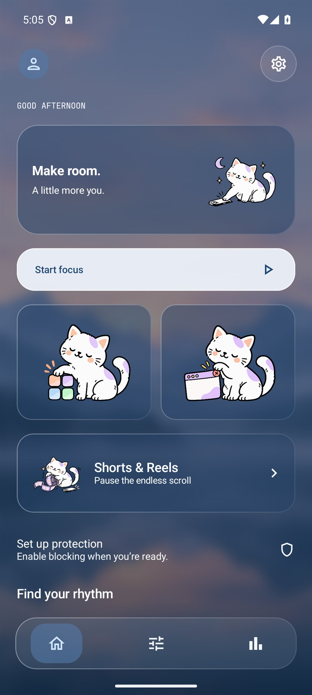
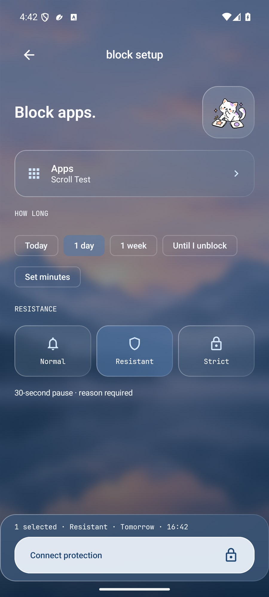
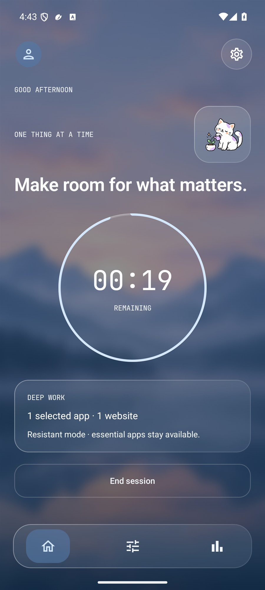
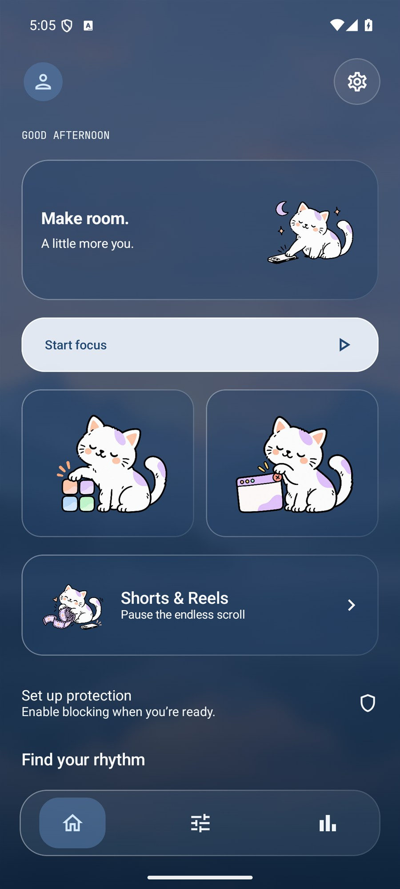
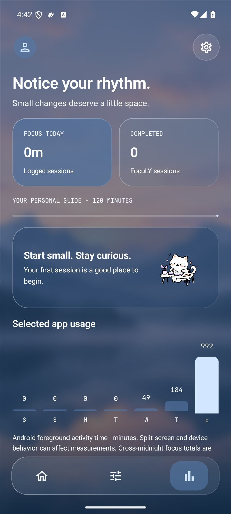
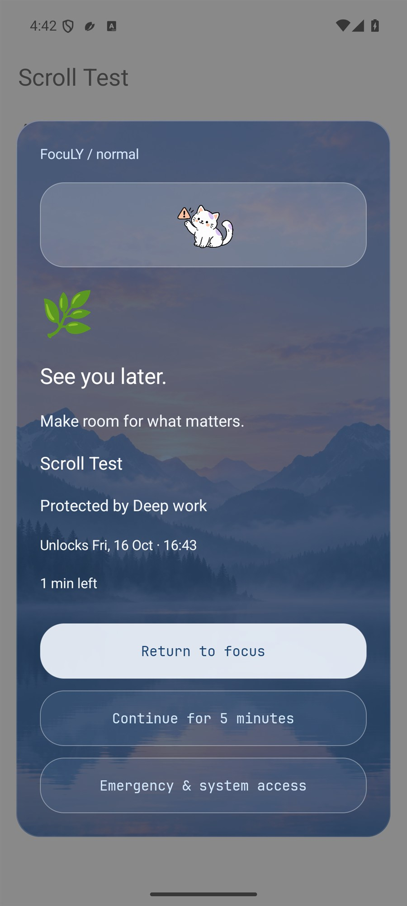
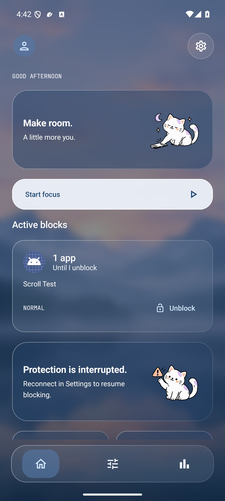
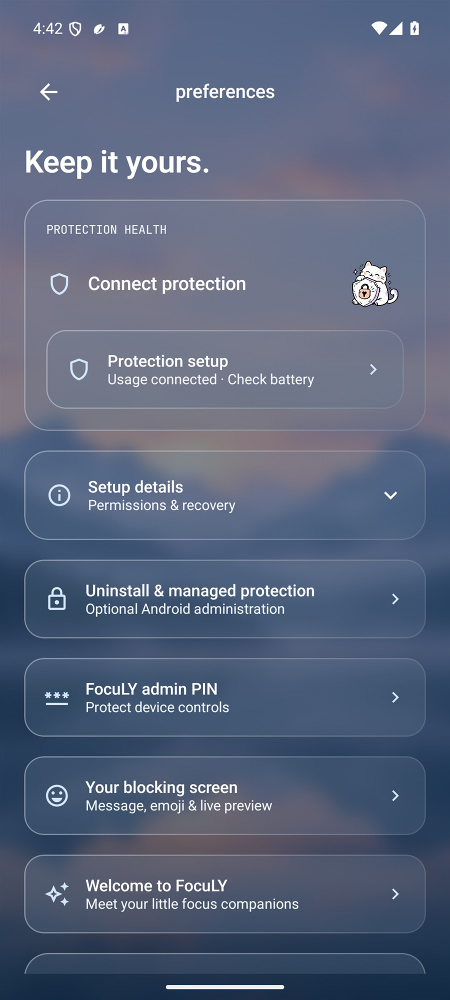
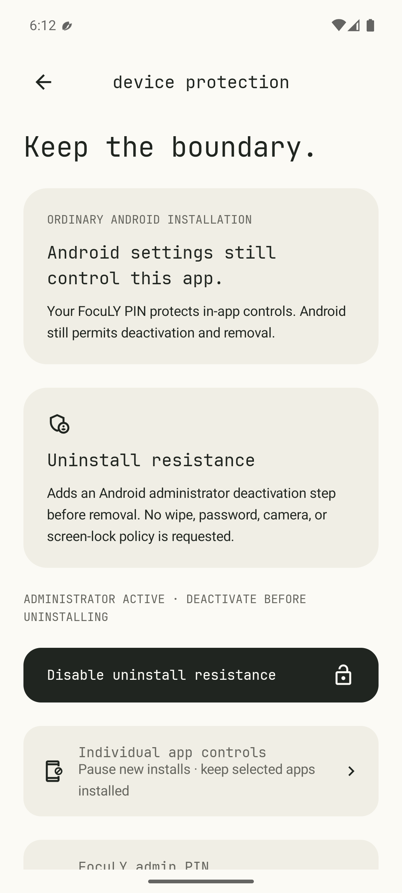

<div align="center">


# FocuLY

### A little less scroll. A little more you.

A calm Android app for intentional screen time, focus sessions, and everyday boundaries.

**FocuLY is the new name for Focus.** Version 1.3.0 brings a scenic glass interface, simpler direct blocking, and larger cat illustrations. Existing installations retain their package, saved rules, and signing identity. [Glass design and current screenshots](docs/GLASS_DESIGN.md).

[](https://github.com/YumiNoona/Focus/actions/workflows/android.yml)
[](https://github.com/YumiNoona/Focus/releases/latest)
[](#installation)
[](app/build.gradle.kts)
[](#design)
[](#privacy)

**[Download v1.3.0](https://github.com/YumiNoona/Focus/releases/tag/v1.3.0)** · **[Features](docs/FEATURES.md)** · **[Protection setup](docs/TROUBLESHOOTING.md)** · **[Report an issue](https://github.com/YumiNoona/Focus/issues)**

</div>

---

## Meet FocuLY

**New in v1.3.0:** A complete glass interface brings a misty lake backdrop, translucent blue panels, pale buttons, and a floating three-icon dock. Larger illustration-only Home cards open app and website blocking directly, with accessible labels. Shared target sheets, persistent actions, corrected cat doodles, and fixes for restoring drafts and refreshing blocking screens make everyday setup smoother. See the [glass design and current screenshots](docs/GLASS_DESIGN.md) and [simpler flows](docs/SIMPLER_FLOWS.md).

**New in v1.2.0:** independent blocks, permission onboarding, FocuLY admin PIN, custom blocking messages with mode previews, direct Shorts/Reels actions, and individual managed app controls. Distinct doodles accompany reminders, patience, Strict boundaries, growing focus, breaks, and completion.

FocuLY helps you choose what deserves your attention and make room for it. Start a quiet session, give distracting apps a daily allowance, or put focus on a recurring schedule. When a distraction appears, a calm interruption gives you a chance to return to what you intended to do.

The interface has exactly **three bottom-dock icons: Home, Rules, and Insights**. Profile lives at the top left; Settings lives at the top right. No account, advertising, analytics, or subscription is built into this release.

## Screenshots

The v1.3.0 gallery shows the glass interface, retained cat doodles, and actual native blocking screens.

**[Current glass gallery](docs/screenshots/glass/README.md)** · [Design guide](docs/GLASS_DESIGN.md). The [earlier v1.2.0 gallery](docs/screenshots/gallery/README.md) and [HTML gallery](docs/screenshots/gallery/index.html) remain historical records, including managed-device comparisons.

<table>
  <tr>
    <td align="center"><b>Home</b></td>
    <td align="center"><b>Block setup</b></td>
    <td align="center"><b>FocuLY session</b></td>
  </tr>
  <tr>
    <td></td>
    <td></td>
    <td></td>
  </tr>
  <tr>
    <td align="center"><b>Dark theme</b></td>
    <td align="center"><b>Insights</b></td>
    <td align="center"><b>Intentional pause</b></td>
  </tr>
  <tr>
    <td></td>
    <td></td>
    <td></td>
  </tr>
</table>

Screenshots are captured from the actual Android app in an emulator. Scroll Test is a separate test app used to demonstrate blocking; it is not included in the installed FocuLY app. Usage history is not fabricated.

<details>
<summary>Independent blocks and compact setup</summary>





These screens are captured from the Android app; independent blocks also work without a focus session.

</details>

<details>
<summary>Optional uninstall and managed-device controls (earlier design)</summary>




Personal-phone administration adds a deactivation step. Separately provisioned device-owner management can enforce Android uninstall blocking and whole-app suspension.

</details>

## What’s included

| Area | Features |
| --- | --- |
| **FocuLY sessions** | Custom durations and intentions; reusable presets; open-ended Normal/Resistant sessions; finite Strict sessions |
| **App boundaries** | Whole-app blocking during focus; daily usage budgets; time per visit; essential-app exceptions |
| **Gradual reduction** | Reduce an app’s allowance by five minutes per day toward a chosen target; pause and resume |
| **Routines** | Weekdays, weekends, custom days, and overnight schedules; advance reminders; overlap detection |
| **Interruption modes** | Normal popup, Resistant waiting period and reason, Strict with no temporary visits or early ending |
| **Independent blocks** | Apps, websites, and feeds for today, one day, one week, custom minutes, or until manually unblocked; work without a focus session |
| **Uninstall protection** | Optional administrator deactivation step on personal phones; verified Android uninstall blocking and app suspension on separately provisioned managed devices |
| **Setup & PIN** | Final onboarding permission checklist, optional 6–12 digit FocuLY admin PIN, temporary unlock, cooldown, Android screen-lock recovery outside Strict |
| **Your blocking screen** | Custom headline, optional supporting text, emoji, presets, and live preview |
| **Individual app controls** | Managed per-app uninstall policy and launch quarantine after installation, including rules prepared before installation; day/week/manual durations |
| **Insights** | Logged focus time, completed sessions, personal goals, measured app usage, weekly chart, prior-week comparison when data is available, and session history |
| **Everyday access** | Home-screen widget, Quick Settings tile, optional notifications, and permission health |
| **Privacy & appearance** | Local storage, JSON export, deletion, consent withdrawal, hidden insights, light/dark themes, reduced motion, and optional haptics |
| **Experimental rules** | Website domains in supported browser address fields; selective YouTube Shorts, Instagram Reels, and Facebook Reels detection |

Read the [full feature and coverage guide](docs/FEATURES.md) for details about rule precedence, timing, and measured usage.

### Block without a session

Tap the **apps cat** or **browser cat** card on Home, or select a group in Rules. Screen readers announce the cards as **Block apps** and **Block websites**. Pick **Today**, **1 day**, **1 week**, **Set minutes**, or **Until I unblock**, then choose a resistance mode and tap **Block now**. Home shows every active group and its ending. Blocks persist across app restarts and remain active when a focus session ends.

Strict needs an automatic expiry. “Until I unblock” supports Normal and Resistant; Resistant unblocking requires a 30-second pause and a reason. The [blocking guide](docs/BLOCKS.md) explains calendar timing, overlaps, and coverage. Permission setup uses compact action cards with expandable details. Draft choices survive navigation to Settings and back.

### Choose your resistance

| Mode | When a selected app opens | Leaving the restriction |
| --- | --- | --- |
| **Normal** | Compact popup | Continue for the configured visit duration; reason optional |
| **Resistant** | Full-screen interruption | Wait 30 seconds, give a reason, then get one minute; at least ten minutes between visits |
| **Strict** | Full-screen lock until the deadline | No temporary visits, early stop, rule weakening, or data deletion within FocuLY; existing visits are ignored |

Strict requires a live protection service and an automatic ending. Sessions can last up to one week; independent blocks can use today, one day, or one week. Home, emergency access, and Android settings remain accessible. Ordinary phones allow Android permission revocation. For Android-enforced whole-app suspension and uninstall blocking, see the opt-in [managed-device guide](docs/MANAGED_DEVICE.md).

## Installation

**Requires Android 9 / API 28 or newer.**

1. Open the [v1.3.0 release](https://github.com/YumiNoona/Focus/releases/tag/v1.3.0).
2. Download **`FocuLY-v1.3.0.apk`** and open it on your Android phone. The same release certificate supports updating an existing Focus installation.
3. If Android asks, allow installation from the browser or file manager you are using.
4. Launch **FocuLY** and follow the four-screen introduction to the permission checklist.
5. Read the protection disclosure and enable **FocuLY protection** in Android Accessibility settings if you want blocking.
6. Enable **Usage Access** for daily budgets and usage charts. Notifications are optional.
7. Choose distractions under **Rules**. In **Settings → Protection health**, check that the service is connected, then verify a block by opening a selected app while a rule is active.
8. Start your preferred session from **Home**. For OnePlus Nord CE 2 background settings, follow [troubleshooting](docs/TROUBLESHOOTING.md).

Some Android versions place additional restrictions on accessibility access for sideloaded apps. If needed, allow restricted settings from FocuLY’s system App Info screen before enabling protection.

The APK is release-signed for GitHub distribution and uses the same certificate as v1.0.0, so it installs as an update and preserves local data. It has not been submitted to Google Play. Debug builds and the earlier Still preview use different certificates. There is no JSON import feature.

## Permissions, explained

| Access | Purpose | What happens without it |
| --- | --- | --- |
| **Accessibility** | Observe the current app, exposed browser address fields, and selected feed controls; show restrictions you choose | FocuLY timers work, but blocking is unavailable |
| **Usage Access** | Read Android foreground activity events for daily budgets and usage insights | Session app blocking and visit limits can work; daily budgets and measured usage are unavailable |
| **Notifications** | Session status, completion, and optional routine reminders | Sessions and rules still work |
| **Boot/time broadcasts** | Reconcile saved session deadlines and replan reminders after reboot or time changes | Managed automatically by Android |
| **Vibration** | Optional haptic feedback on primary actions | Can be disabled in FocuLY settings |
| **Device administrator** | Optional uninstall resistance: Android requires deactivation before uninstalling | No uninstall resistance; no wipe/password/camera/lock policy is requested |
| **Exact alarms** | Precise release of managed Strict app suspension | Managed Strict cannot start; ordinary sessions do not require this permission |

FocuLY requests no network permission. Permission setup is progressive, and blocking status uses the service's live heartbeat. Consent withdrawal inside FocuLY is locked during Strict; Android settings remain available. Device-owner management is a separate provisioning requirement, not a permission a personal-phone app can grant itself.

## Coverage and limitations

- **App blocking:** a user-consented accessibility overlay interrupts selected apps. Phone, emergency access, your launcher, system settings, and FocuLY remain available.
- **Website rules:** experimental address-field detection in Chrome, Edge, Brave, and Firefox during focus. Hidden fields, private browsing, embedded browsers, and app updates can bypass detection. Whole-browser blocking is the available fallback.
- **Feed rules:** experimental detection using third-party accessibility controls and view identifiers. Current production versions of YouTube, Instagram, and Facebook have not all been verified. Use whole-app rules when selective detection misses a feed.
- **Strict mode:** no in-app escape before the deadline. Android settings can still disable accessibility on an ordinary phone. Optional administrator activation adds a deactivation step before uninstalling; actual uninstall blocking requires device-owner provisioning.
- **Background behavior:** OEM restrictions can stop accessibility protection. FocuLY rechecks application windows every 500 ms and displays connection failures. Ordinary reminders are inexact. Managed Strict uses exact alarms; reboot recovery may wait for the first unlock.
- **Measurements:** Android foreground usage is not a measurement of attention. Split-screen behavior, event availability, and time behind an overlay can affect it. Cross-midnight daily focus totals are apportioned estimates; ongoing sessions enter logged totals when ended.

The [validation record](VALIDATION.md) separates verified behavior from remaining device coverage.

## Design

A misty lake backdrop, translucent blue-grey cards, fine glass edges, pale primary buttons, and a floating three-icon dock. Clear sans-serif headings and body copy pair with bundled JetBrains Mono timers and small labels. Light and deeper dark glass themes keep the same navigation and direct blocking flows. See [the design guide](docs/GLASS_DESIGN.md).

- **Type scale:** 44 / 28 / 24 / 20 / 18 / 16 / 14 / 12 sp.
- **Spacing:** 4 dp grid; 24 dp page and card padding; 24 dp section gaps.
- **Interaction:** minimum 48 dp targets; primary buttons at least 56 dp tall and able to grow with text.
- **Accessibility:** labeled navigation icons, selected states, scrolling content, font scaling, and quiet motion.
- **Themes:** system, light, and dark, with equivalent screen structure.

Slice’s spacious visual rhythm was an inspiration. FocuLY contains no Slice assets, code, or branding.

## Build from source

Prerequisites: **JDK 17+**, **Android SDK 36**, and Android Studio or Android command-line tools. The repository includes the Gradle wrapper.

```bash
git clone https://github.com/YumiNoona/Focus.git
cd Focus
./gradlew assembleDebug
```

On Windows:

```powershell
git clone https://github.com/YumiNoona/Focus.git
cd Focus
.\gradlew.bat assembleDebug
```

Android Studio can create `local.properties` with your SDK path. Alternatively, set `ANDROID_HOME` to your SDK installation. Do not commit machine-specific SDK paths.

Debug output: `app/build/outputs/apk/debug/app-debug.apk`.

### Signed release builds

The release build enables R8 optimization and resource shrinking. Signing credentials are supplied locally through ignored `keystore.properties`, or with environment variables:

| Property | Environment variable |
| --- | --- |
| `storeFile` | `FOCUS_STORE_FILE` |
| `storePassword` | `FOCUS_STORE_PASSWORD` |
| `keyAlias` | `FOCUS_KEY_ALIAS` |
| `keyPassword` | `FOCUS_KEY_PASSWORD` |

Copy [keystore.properties.example](keystore.properties.example) to `keystore.properties` and supply your private keystore details, then run:

```bash
./gradlew assembleRelease
```

Without signing configuration, this produces an **unsigned** release APK. The official release’s signing key is deliberately excluded from the repository; only the maintainer can create updates with that same certificate. Keep the key and its credentials backed up privately. Using a different certificate requires uninstalling the previous app.

### Tests and CI

```bash
./gradlew testDebugUnitTest lintDebug assembleDebug
./gradlew connectedDebugAndroidTest  # connected device/emulator required
```

The optional `test-fixture` project supplies a local distraction app for the accessibility regression. Build it with `./gradlew -p test-fixture assembleDebug`, then install its debug APK on an isolated emulator before connected tests. The scenario skips personal phones and emulators without the fixture. See [VALIDATION.md](VALIDATION.md) for test counts, scope, and remaining device coverage.

[GitHub Actions](.github/workflows/android.yml) runs JVM tests, Android lint, and debug assembly on pushes and pull requests. It uploads debug APKs and available reports as workflow artifacts. It does not contain release signing secrets or run the connected-device suite.

## Project structure

```text
FocuLY/
├── app/
│   ├── build.gradle.kts              # Android config and optional signing
│   ├── proguard-rules.pro            # Release diagnostics / R8 rules
│   └── src/
│       ├── main/
│       │   ├── java/dev/still/focus/
│       │   │   ├── Engine.kt         # Pure rules, schedules, sessions, domains
│       │   │   ├── Repository.kt     # Persistence, export, usage aggregation
│       │   │   ├── MainActivity.kt   # Screens, navigation, forms, permissions
│       │   │   ├── Theme.kt          # Colors and typography
│       │   │   ├── FocusAccessibilityService.kt
│       │   │   └── Integrations.kt   # Notifications, alarms, widget, tile
│       │   └── res/                  # Font, icon, widget, service configuration
│       ├── test/                     # JVM rules tests
│       └── androidTest/              # Android UI and JSON round-trip tests
├── docs/                             # Feature guide, branding, screenshots
├── .github/workflows/android.yml     # Build automation
├── gradle/wrapper/                   # Reproducible Gradle entry point
├── CHANGELOG.md
├── CONTRIBUTING.md
├── SECURITY.md
├── THIRD_PARTY_NOTICES.md
└── VALIDATION.md
```

The application ID remains `dev.still.focus` from the initial preview. That internal identifier does not affect the FocuLY display name.

## Privacy

Your chosen rules, profile information, session history, and override reasons stay in local app storage. Screen content is checked in memory and is not recorded or transmitted. Analytics, advertising, account creation, and cloud sync are absent. Android usage events are read locally for budgets and insights.

Export includes personal intentions and override reasons; choose its destination carefully. **Delete my data** clears FocuLY’s local records and ends its active session, while Android’s system usage history remains managed by Android. Cloud backup and device transfer are excluded by the app’s extraction rules. History and override records retain the latest 1,000 entries each.

## Contributing and notices

See [CONTRIBUTING.md](CONTRIBUTING.md) for development expectations and [SECURITY.md](SECURITY.md) for sensitive reports. Features and fixes are welcome through issues and pull requests.

JetBrains Mono uses the SIL Open Font License; its complete notice is in [FONT-LICENSE.txt](FONT-LICENSE.txt). See [THIRD_PARTY_NOTICES.md](THIRD_PARTY_NOTICES.md) for bundled dependencies and brand references.
