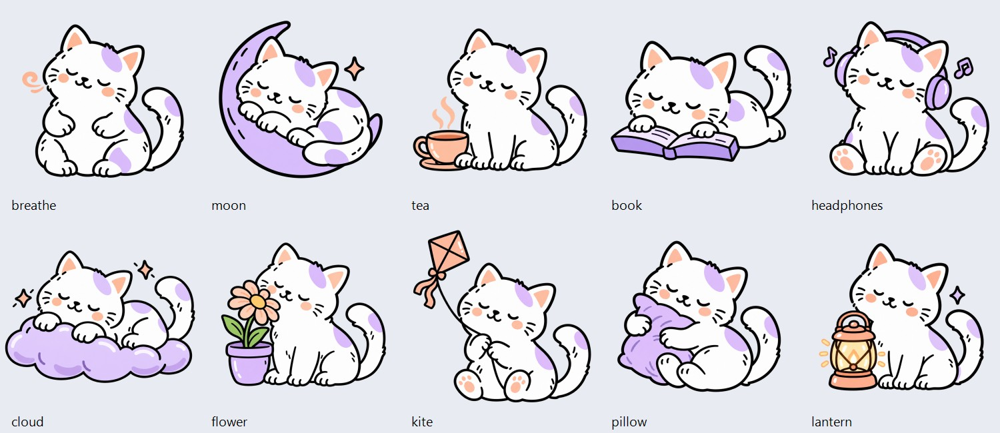

# Your blocking screen

Open **Settings → Your blocking screen**. Choose a mode to preview its behavior, then personalize the illustration, emoji, headline, and supporting message. **Save blocking screen** stays at the bottom while you scroll. It saves the design for all blocking modes; changing the preview mode never changes enforcement.

## Cat illustrations

The illustration strip offers the existing Reminder, Patience, and Boundary cats plus ten new scenes: Breathe, Moon, Tea, Book, Headphones, Cloud, Flower, Kite, Pillow, and Lantern. Swipe across to see them. **Match mode** restores the original mode-specific cats; **No illustration** hides the artwork.

The new assets are bundled transparent PNGs in `app/src/main/res/drawable-nodpi/cat_*.png`. They were created with built-in imagegen using `cat_patience.png` as a style reference. The complete prompts are recorded in [illustration-prompts.json](illustration-prompts.json).

[Actual Android screen captures](screenshots/personalization/README.md) include the new onboarding ring, app picker, artwork/emoji controls, imported-image preview, and native popup.

## Personal images and stickers

Tap **Add image or sticker**, choose an image through Android, and save. Transparent PNG/WebP stickers keep their transparency. Animated formats use a still frame. **Replace your image** chooses another; **Remove your image** returns to the selected cat or automatic mode. You can also select a cat directly to replace a personal image.

The app copies the selected image into private, on-device storage, so it does not depend on a temporary picker permission or the original remaining in your gallery. It requests no broad media/storage permission, downloads no URL, and uploads nothing. Inputs are limited to 20 MB; supported images are decoded at no more than 1024 pixels on the longest edge and stored as PNG. Unreadable images leave the prior selection intact.

Saved private images are used by both the Compose preview and the actual Android accessibility overlay. Missing files fall back to the selected/default cat. JSON exports retain the local image identifier, not image bytes; the private images are excluded from Android backup and are removed by FocuLY's **Delete local data** action. Superseded images are cleaned up after saving.

Existing installations default to their original mode artwork. Personalization does not weaken blocking, alter permission consent, or change managed-device policies. Message and illustration saves remain unavailable while Strict is active.

## Floating controls

Onboarding shows four circular progress segments around Next/Done, with an accessible “step X of 4” description. The last checklist scrolls beneath the floating control, with space to reach its final option. The full app picker similarly floats Done over the list, with bottom scroll space rather than a rectangular footer. The three-icon main dock is unchanged.
