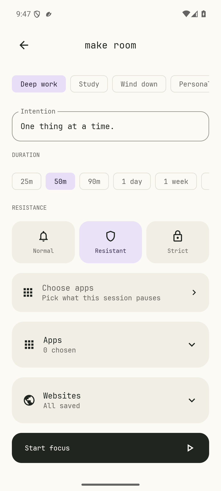
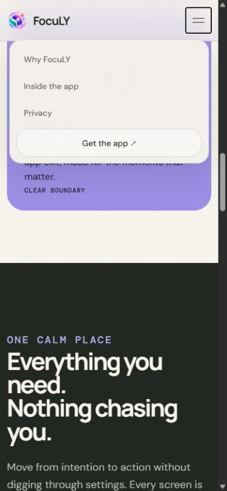

# Flow review — 15 October 2026

Reviewed the Android and web updates through `d66070c`, preserving the newer illustrated Home, editable profiles, continuous sessions, typography, and website design.

## Fixes

| Trigger | Previous behavior | Result |
| --- | --- | --- |
| Android recreates an editor, including after a configuration change | Navigation returned to the requested landing screen; transient selected objects disappeared | Restore the current route and stable app/profile/routine identifiers, alongside editor drafts |
| Recreate a routine with custom days | Days reverted and an edited routine could lose its identity | Preserve selected days and the routine ID; saving updates the existing routine |
| Choose the focus-plant illustration for the built-in Study/Wind down profile, then reopen saved data | Legacy defaults replaced the explicit choice | Use legacy art defaults only when the stored art field is absent |
| Resistance changes while a feed overlay is parked over Home | The old Normal visit button could remain visible | Use the common restriction evaluation path and rebuild the overlay for the current mode |
| Withdraw consent while that overlay is parked | The special branch could keep showing the overlay | Apply consent checks before evaluation and release the overlay/audio focus |
| Open routine setup with empty profile data | The first-profile lookup could crash | Show a create-profile action and keep Save disabled until a valid profile exists |
| A session cannot start, or its scope has no targets | Failure redirected to Settings; target selection was hidden in details | Retain the session draft and offer direct app selection |
| Navigate website previews with a keyboard | Tab roles had no arrow-key behavior or linked panels | Roving focus, Arrow Left/Right, Home/End and linked panel labels |
| Collapse the mobile menu | Invisible links could still receive keyboard focus | Hide collapsed links from focus; close with Escape, outside click, or navigation |

The existing profile menu continues to prevent deletion of the final profile. Empty-data handling is an additional recovery path. No removed Pomodoro functionality is reintroduced.

## Validation

- 22 JVM engine tests and the final combined 20 Android checks pass (16 UI/backend, 2 PIN, 2 native overlay). Android debug/test assembly, lint, and the optimized release build pass; the production web build passes.
- Android regressions cover app-rule draft recreation, edited profile identity/artwork, routine identity/days, empty-profile recovery, explicit navigation followed by recreation, and legacy/current profile serialization.
- Native overlay checks use a separately installed Scroll Test fixture. The parked-overlay regression exercises the parking flag with a real accessibility overlay, verifies Normal-to-Resistant refresh and consent withdrawal, and does not claim third-party feed detection coverage.
- Existing Normal visit, Resistant wait/reason, Strict enforcement, transient-window, independent-block, expiry and PIN checks remain covered.
- Browser checks verify preview Arrow/Home/End navigation and the selected image, mobile closed-link visibility, opening the menu, Escape focus return, and closing after navigation at 390 × 844. The temporary viewport override is reset afterward.

Run Android checks only on an isolated emulator: the suite resets local app data. The physical OnePlus Nord CE 2 was not connected. Website and selective feed detection remain experimental; ordinary-phone Android administration limits are unchanged.

## Reproduce

```powershell
./gradlew.bat :app:testDebugUnitTest :app:lintDebug :app:assembleDebug :app:assembleDebugAndroidTest
adb -s emulator-5554 install -r app/build/outputs/apk/debug/app-debug.apk
adb -s emulator-5554 install -r app/build/outputs/apk/androidTest/debug/app-debug-androidTest.apk
adb -s emulator-5554 shell am instrument -w -e class dev.still.focus.AppTest,dev.still.focus.AdminPinTest,dev.still.focus.ProtectionScenarioTest dev.still.focus.test/androidx.test.runner.AndroidJUnitRunner
```

The optional fixture must be installed before running native overlay checks. From `web`, run `npm ci` and `npm run build`.

## Actual screen checks



