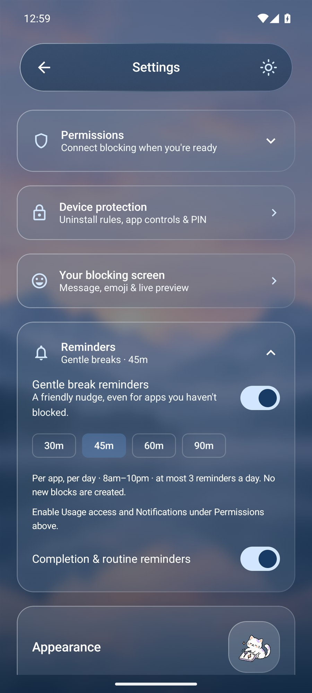
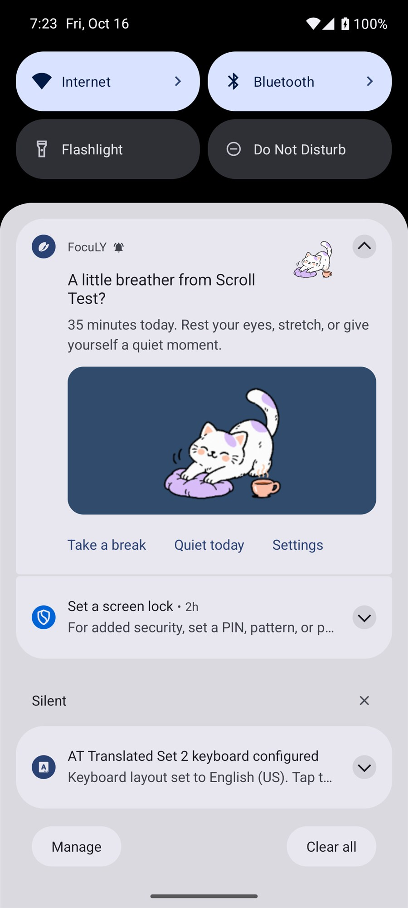

# Reinstall protection and gentle breaks

## Removing a blocked app

FocuLY saves rules by Android package ID, independently of installation status. Uninstalling Instagram does not delete its app rule, profile selection, routine, or active ban. Reinstalling the same package resumes enforcement while that ban is alive. Rules shows **Not installed · rule kept** while a selected app is absent.

Timed, day, and week bans keep their original absolute end date. Time continues passing while the target app is uninstalled; reinstallation does not restart the timer or make a finite ban permanent. Manual bans remain until explicitly unblocked under their mode's rules. Expired bans do not reactivate after reinstall.

A real removal/reinstall ends any outstanding temporary visit for that package, retaining visit history/cooldown. Ordinary in-place app updates preserve visits. The lifecycle receiver refreshes app status, icons, foreground detection, and usage samples. A managed device also rechecks Android's actual suspension flags rather than trusting a cached target list.

The package must be the same app in the Android user/profile where FocuLY runs. Lite variants, cloned apps, other profiles, and browser access can require separate rules. Daily usage allowances depend on Android's usage history; the original-deadline guarantee here concerns saved bans, not restoration of third-party data erased by Android.

## Removing FocuLY

| Installation | Actual protection |
| --- | --- |
| Ordinary Android administrator | Android requires deactivation before removal. FocuLY supplies a warning and an illustrated protection-change notification; Android still allows deactivation and uninstall. |
| Separately provisioned device owner | Android-enforced FocuLY uninstall blocking while a ban/focus rule/app policy is active, plus an optional persistent removal policy. Android 11+ user-control restrictions resist ordinary force-stop/data clearing. |

The managed monitor's ongoing cat notification reflects the policy verified from Android. Support text identifies the removal restriction where Android displays administrator information. An ordinary app cannot replace Android's uninstall or administrator consent screens with an unbreakable custom password/captcha. FocuLY does not trap Settings or automatically reactivate an administrator the user disabled.

Managed bans also guard date/time configuration and release only restrictions FocuLY recorded as its own. Existing selected whole-app suspension remains optional for managed Strict. Recovery, factory reset, root/privileged tools, other administrators, and permission revocation on ordinary phones remain outside app-level guarantees. Removing FocuLY itself deletes its private rules; the app cannot promise to enforce after its own removal.

See the [managed-device guide](MANAGED_DEVICE.md) for dedicated-device setup. Do not reset your everyday phone to enable this feature. Android references: [uninstall-blocking APIs](https://developer.android.com/reference/android/app/admin/DevicePolicyManager#setUninstallBlocked(android.content.ComponentName,%20java.lang.String,%20boolean)), [administrator deactivation callback](https://developer.android.com/reference/android/app/admin/DeviceAdminReceiver#onDisableRequested(android.content.Context,%20android.content.Intent)).

## Illustrated break notifications

In **Settings → Reminders**, turn **Gentle break reminders** on/off and choose 30, 45, 60, or 90 minutes of daily use per app. The default is 45 minutes. **Settings → Permissions** holds Usage access and Notifications together. Reminders include apps with no saved blocking rule, but exclude essential/system access, nonlaunchable apps, and apps already blocked at evaluation time.

FocuLY uses Android Usage Access on-device and requires notification permission. A separate notification channel can be muted in Android. No account, network access, or new broad permission is introduced. Each notification contains a cat illustration, the app name, measured minutes, **Take a break**, **Quiet today**, and **Settings** actions. It creates no block, launches no app automatically, and imposes no overlay.

Delivery is limited to 8am–10pm local time, once per app per day, at least two hours between notifications, and at most three per day across all apps. Quiet today suppresses suggestions until the next local midnight. These controls remain available during Strict because they do not weaken protection.

The connected protection service samples about once a minute when only reminders need usage data. A persisted 15-minute Android job supplies best-effort checks without that service. Android may delay jobs for sleep, battery limits, force-stop, or vendor background policies; a reminder is not an exact alarm. Allow background activity on OnePlus/OxygenOS if delivery is delayed. Disabling the feature cancels its job/notification; deleting local FocuLY data clears its reminder history.

| Reminder controls | Expanded Android notification |
| --- | --- |
|  |  |

These are real emulator captures. The notification example uses an explicit 35-minute Scroll Test input for validation, not a claim about a user's measured history. Android owns the notification layout; the app supplies the cat artwork, text, and actions.

## Verification

`ReinstallTest` actually uninstalls/reinstalls only the disposable Scroll Test fixture, verifies manual/day/week/Strict-timer bans, original deadlines, saved-state decoding, resumed native blocking, and expiry. `ManagedLifecycleTest` verifies repaired suspension, real uninstall refusal, normal-ban self-protection, clock/user-control restrictions, deadline release, and verified notification wording on a separate device-owner emulator.

`BreakPolicyTest` covers thresholds, unconfigured apps, quiet hours, eligibility, daily limits, cooldown, and skipped blocked apps. `BreakReminderTest` posts a real illustrated notification using explicit fixture usage input, verifies its actions/artwork and saved preferences, deduplicates it, and tests Quiet today and disabling. It does not claim a fabricated history is measured user activity. Use isolated emulators; package tests are unsuitable for personal phones.
