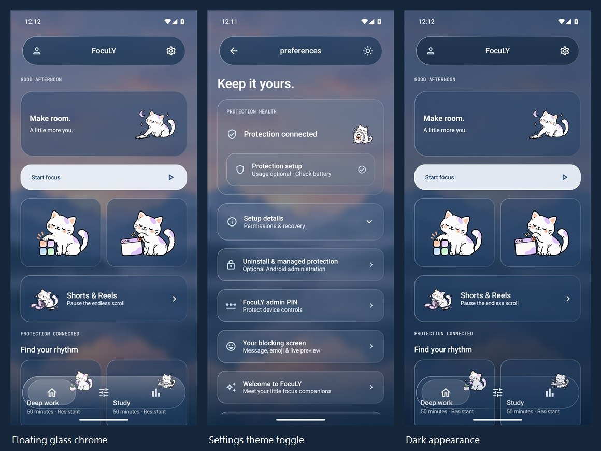

# Floating glass dock — 30 October 2026

Actual Android 15 emulator captures of the new FocuLY v1.0.0 (Android build 125), after inspecting Stash's dock implementation. The capsule is a translucent overlay: cards pass behind it, the margins stay open, and extra trailing scroll space lets final actions move above it. There are still exactly three destinations, with Profile and Settings in the header.

| Screen | Capture |
| --- | --- |
| Home | [View](dock-01-home.jpg) |
| Scrolling behind the glass | [View](dock-02-scroll-through.jpg) |
| Rules selected | [View](dock-03-rules.jpg) |
| Insights selected | [View](dock-04-insights.jpg) |
| Dark Home, Reduce motion enabled | [View](dock-05-dark-home.jpg) |
| Dark scrolling content | [View](dock-06-dark-scroll.jpg) |
| 130% text size | [View](dock-07-large-text.jpg) |
| Final profile actions scrolled clear of the dock | [View](dock-08-last-actions.jpg) |

Captured with the opt-in `ScreenshotGalleryTest#captureFloatingDock` on a disposable emulator. Scroll Test is an installed fixture; the captures contain no fabricated usage statistics. JPEGs are resized to 900 px wide, and the overview combines three unchanged captures. The gallery checks physical tap clearance above the dock and opens the last profile at 130% text size. Separate functional checks cover selected-tab state, scroll restoration, direct blocking, and a real native app interruption.

The current tab uses a 180 ms sliding pill, or a direct snap with Reduce motion enabled. The app does not capture or blur other apps' pixels. [Design details](../../DESIGN.md) · [Validation](../../VALIDATION.md).
