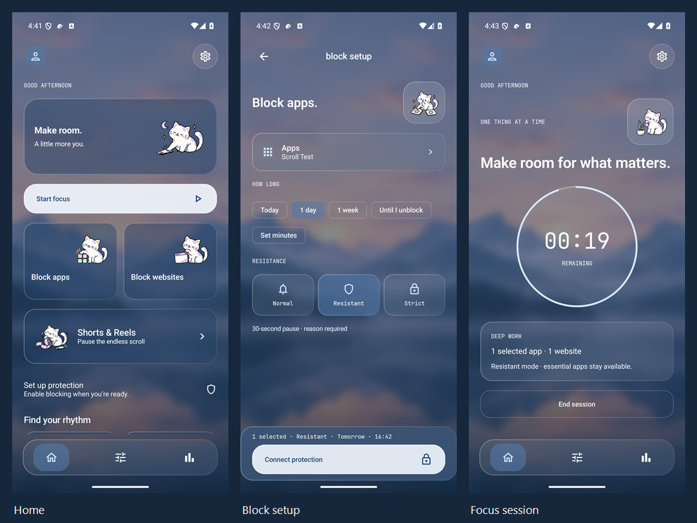

# FocuLY glass gallery — 16 October 2026

Actual Android 15 emulator captures from the glass-interface development build. The app uses the new bundled landscape, translucent cards, floating three-icon dock, and corrected cat artwork. Scroll Test is a separately installed fixture; usage history is not fabricated. Screenshots are resized to 900 px wide and exported as JPEG for repository size; the overview combines three real captures without changing their content.

| Screen | Capture |
| --- | --- |
| Welcome | [View](01-welcome.jpg) |
| Onboarding rhythm | [View](01b-onboarding-rhythm.jpg) |
| Onboarding boundary | [View](01c-onboarding-boundary.jpg) |
| Onboarding protection | [View](02-onboarding-permissions.jpg) |
| Protection disclosure | [View](03-protection-disclosure.jpg) |
| Home | [View](04-home.jpg) |
| Saved app rules | [View](05-rules-apps.jpg) |
| App limits | [View](06-app-rule.jpg) |
| App picker | [View](07-app-picker.jpg) |
| Always allowed | [View](08-always-allowed.jpg) |
| Saved websites | [View](09-rules-websites.jpg) |
| Website blocking | [View](10-block-websites.jpg) |
| Feed controls | [View](11-rules-feeds.jpg) |
| Reels blocking | [View](12-block-reels.jpg) |
| Routines | [View](13-rules-schedules.jpg) |
| Routine editor | [View](14-schedule-editor.jpg) |
| Focus setup | [View](15-session-setup.jpg) |
| Profiles | [View](16-profile.jpg) |
| Profile editor | [View](17-profile-editor.jpg) |
| Insights | [View](18-insights.jpg) |
| Settings | [View](19-settings-health.jpg) |
| Appearance | [View](19c-appearance.jpg) |
| Device protection | [View](20-device-protection.jpg) |
| Individual app controls | [View](21-individual-app-controls.jpg) |
| Admin PIN | [View](22-admin-pin.jpg) |
| PIN dialog | [View](22b-pin-setup.jpg) |
| Custom blocking screen | [View](23-custom-blocking-screen.jpg) |
| Protection checklist | [View](24-permissions-checklist.jpg) |
| App blocking | [View](25-block-apps.jpg) |
| Active blocks | [View](26-active-blocks.jpg) |
| Normal popup | [View](27-normal-popup.jpg) |
| Resistant warning | [View](28-resistant-screen.jpg) |
| Strict warning | [View](29-strict-screen.jpg) |
| Active focus | [View](30-active-session.jpg) |
| Dark Home | [View](31-dark-home.jpg) |
| Ending warning | [View](35-end-session-warning.jpg) |
| Completed session | [View](36-session-complete.jpg) |
| Unblock warning | [View](37-unblock-warning.jpg) |
| Protection warning | [View](38-protection-warning.jpg) |
| Dark focus | [View](40-dark-focus.jpg) |
| Search with keyboard | [View](simple-05-search-keyboard.jpg) |
| Website selection | [View](simple-10-choose-websites.jpg) |
| 130% focus text | [View](simple-17-large-focus.jpg) |
| 130% selection | [View](simple-18-large-apps.jpg) |
| 130% with keyboard | [View](simple-19-large-keyboard.jpg) |

The capture suite covers onboarding, disclosure, the principal editors, profile/routine controls, protection settings, PIN dialog, custom messages, three actual native blocking modes, active focus, warnings, completion, dark mode, keyboard use, and 130% text scale. Managed pages show the ordinary emulator's actual capabilities; no device-owner status is fabricated. Earlier pastel galleries remain historical.

Reproduce with `ScreenshotGalleryTest` and `-e gallery true` on an isolated emulator with Scroll Test installed. [Design, asset prompt, and validation](../../GLASS_DESIGN.md).