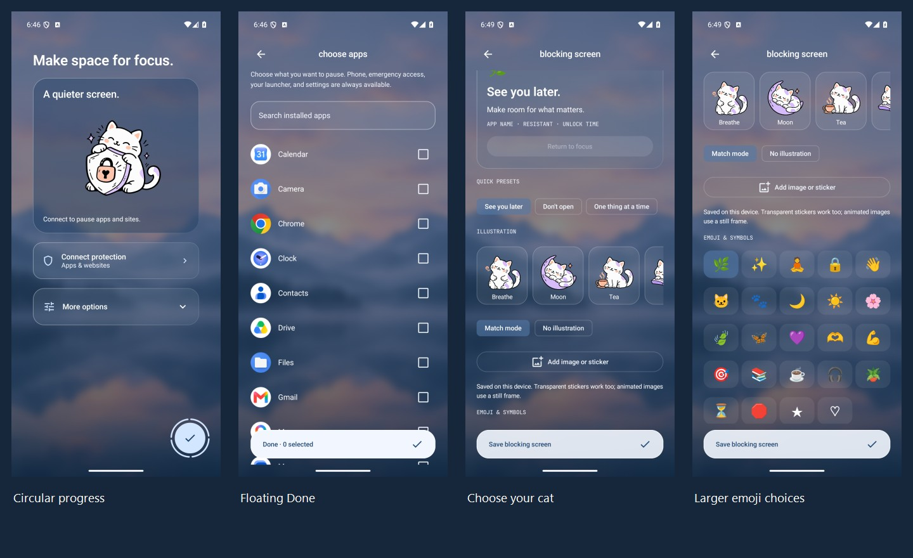

# Personal blocking screens — 16 October 2026

Actual Android 15 emulator captures from the personalization development build after v1.3.0. The floating controls share the backdrop without a rectangular footer panel. The image import example uses the bundled Tea illustration copied through the same private-image import pipeline; no personal user photo is published. Scroll Test is a separately installed blocking fixture.

| Screen | Capture |
| --- | --- |
| Welcome / first progress segment | [View](personal-01-onboarding.jpg) |
| Rhythm / second segment | [View](personal-01b-onboarding-rhythm.jpg) |
| Boundary / third segment | [View](personal-01c-onboarding-boundary.jpg) |
| Checklist / Done ring | [View](personal-02-onboarding-done.jpg) |
| Expanded permission options | [View](personal-02b-onboarding-options.jpg) |
| App selection / floating Done | [View](personal-03-app-picker.jpg) |
| Blocking preview | [View](personal-04-message-preview.jpg) |
| Cat choices and image import | [View](personal-05-cat-choices.jpg) |
| Larger emoji and symbols | [View](personal-06-emoji.jpg) |
| Imported-image preview | [View](personal-07-custom-image.jpg) |
| App selection at 130% text size | [View](personal-08-large-app-picker.jpg) |
| Actual native popup with imported image | [View](personal-09-native-custom-image.jpg) |

## Ten new illustrations

Original transparent assets are bundled in `app/src/main/res/drawable-nodpi/`. [Customization and privacy](../../BLOCKING_ARTWORK.md) · [Complete prompts](../../illustration-prompts.json).

The opt-in `ScreenshotGalleryTest#capturePersonalization` requires `-e gallery true`, an isolated emulator, and Scroll Test installed. It resets/restores local state and font scale and temporarily connects protection to capture the real overlay. Captures are resized to 900 pixels wide for repository size; the overview combines actual captures without changing their content.
