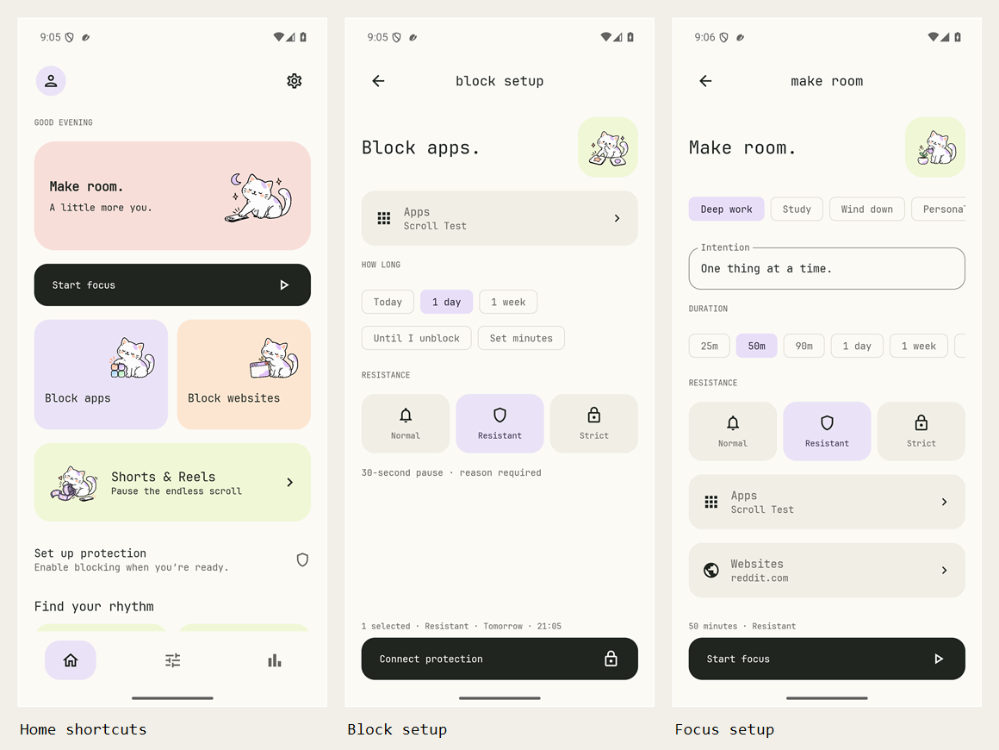

# FocuLY — simpler flows

Actual Android 15 emulator captures, 15 October 2026, from development source after v1.2.0. Scroll Test is a separate test fixture. No fabricated usage history is shown. The original release gallery remains in the neighboring `gallery` directory.

| Screen | Capture |
| --- | --- |
| Home shortcuts | [Light Home](simple-01-home.png) |
| Profiles and feeds | [Home below the fold](simple-02-home-feeds.png) |
| App block setup | [Targets, visible durations, and resistance](simple-03-block-apps.png) |
| App selection | [Searchable selection sheet](simple-04-choose-apps.png) |
| Search and keyboard | [Done remains visible](simple-05-search-keyboard.png) |
| Website block setup | [Add domains directly](simple-06-block-websites.png) |
| Feed block setup | [All supported feed switches](simple-07-block-feeds.png) |
| Focus setup | [Persistent Start action](simple-08-focus.png) |
| Focus targets | [Direct Apps and Websites summaries](simple-09-focus-targets.png) |
| Website selection | [Shared website sheet](simple-10-choose-websites.png) |
| Routines | [Calendar doodle and empty state](simple-11-routines.png) |
| Routine editor | [Days, times, and profile](simple-12-routine-editor.png) |
| Settings | [Consolidated protection entry](simple-13-settings.png) |
| Appearance | [Visible theme and preferences](simple-14-appearance.png) |
| Dark Home | [Dark surroundings and pastel cards](simple-15-dark-home.png) |
| Dark feeds | [Readable controls and doodle](simple-16-dark-feeds.png) |
| Larger focus text | [130% text scale](simple-17-large-focus.png) |
| Larger selection text | [130% app sheet](simple-18-large-apps.png) |
| Larger search text | [130% with keyboard open](simple-19-large-keyboard.png) |

Reproduce using `ScreenshotGalleryTest#captureSimplifiedFlows` with `-e gallery true` on an isolated emulator. The test restores the original font scale and saved demo state afterward. [Flow changes and validation](../../SIMPLER_FLOWS.md).
